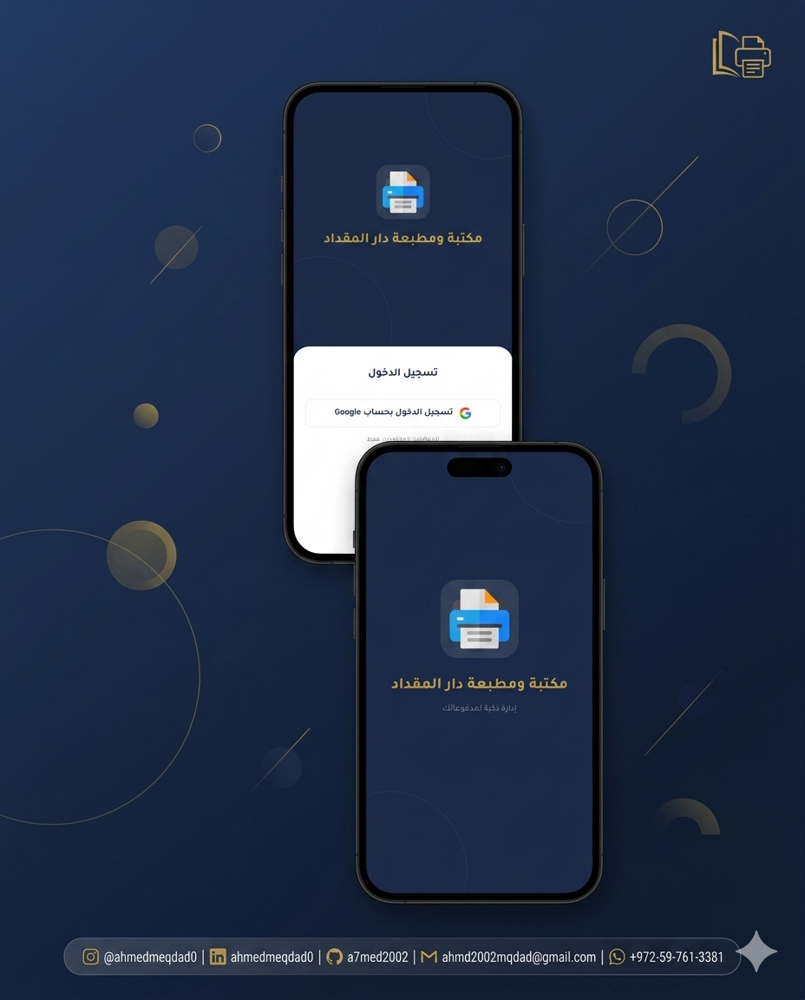
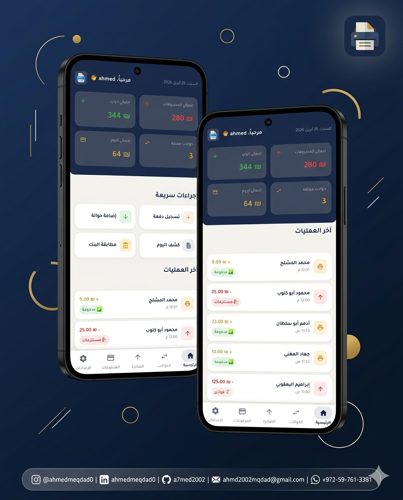
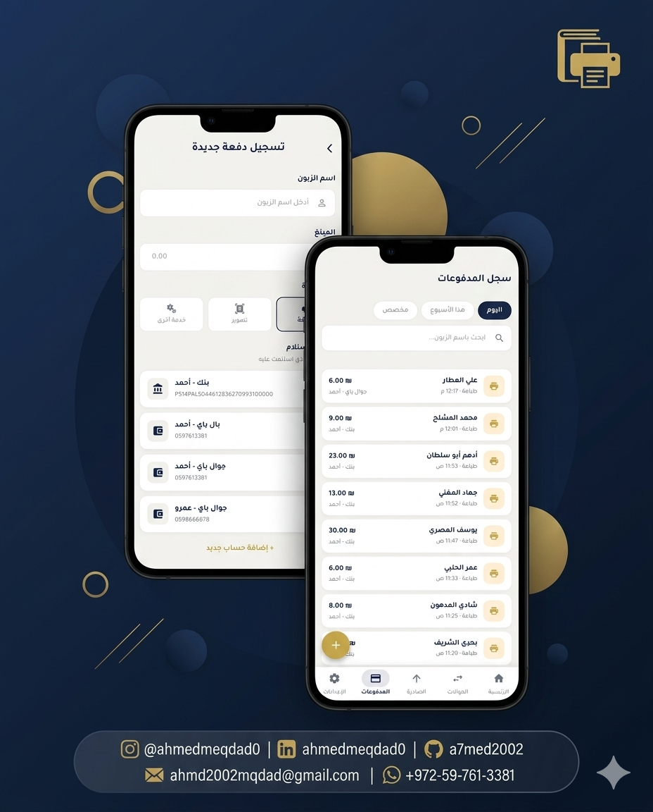
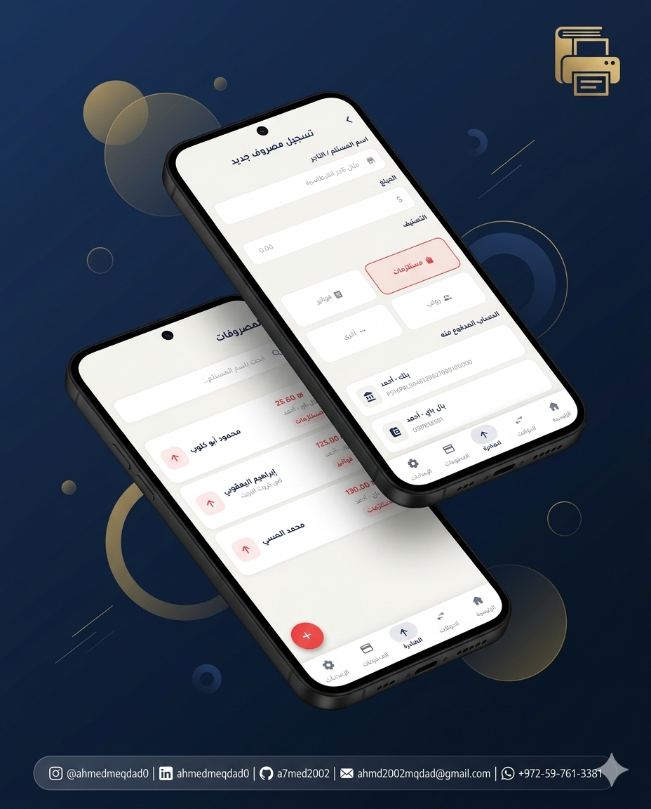
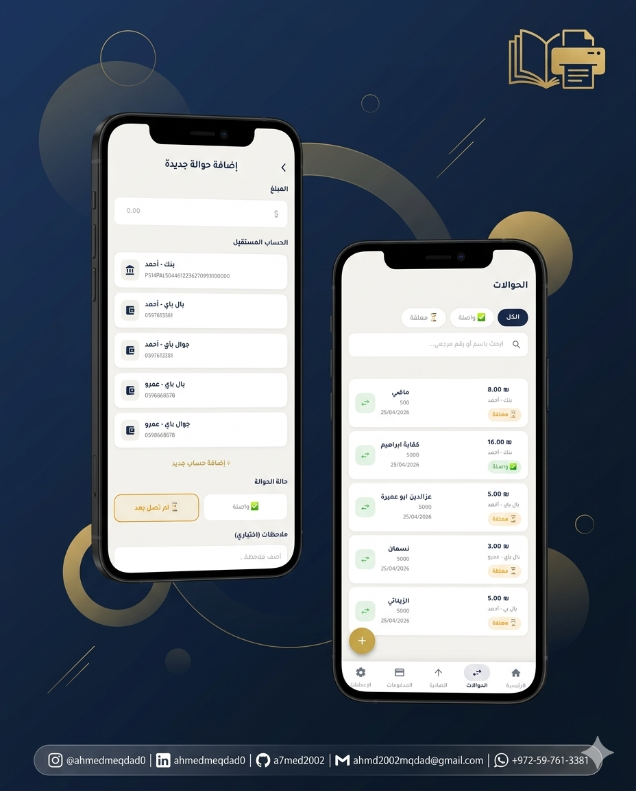
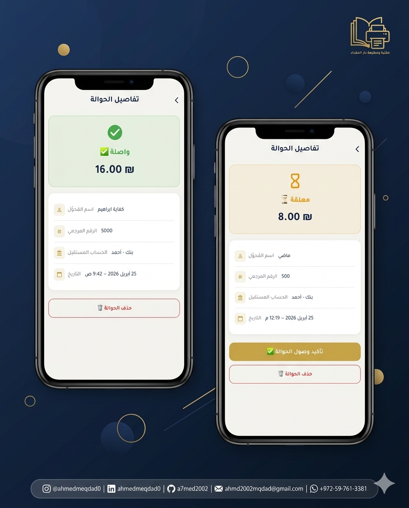
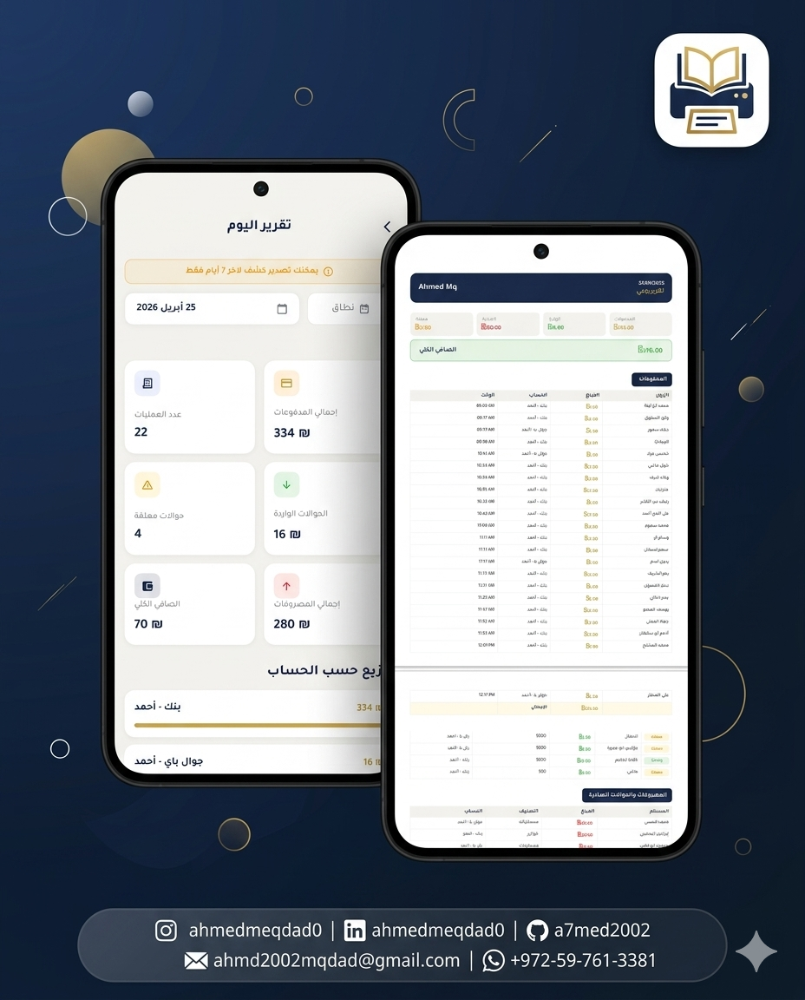
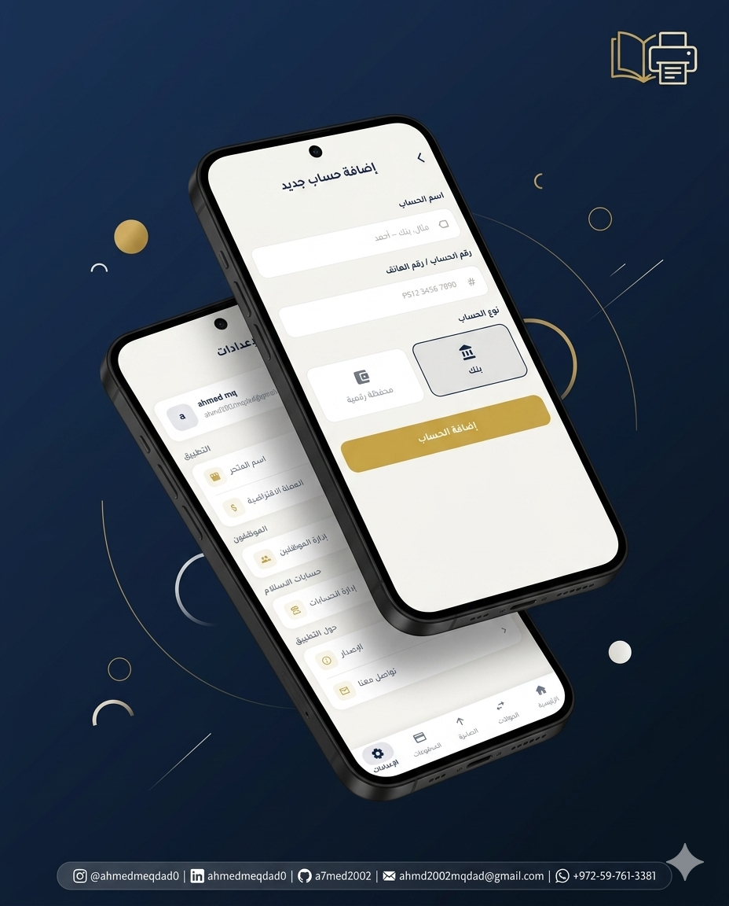

<div align="center">

# 📚 Dar Al-Miqdad — Library & Print Shop Manager

**An Arabic-first, offline-tolerant Flutter app for managing payments, incoming transfers, expenses, and daily reports — with automatic transaction capture from bank and wallet notifications.**


</div>

---

## 📖 Project Overview

**Dar Al-Miqdad** is a business management app built for a library and print shop. It replaces paper notebooks and scattered chat messages with a single, shared system where staff can record everything that moves money in and out of the shop:

- 🧾 **Payments** for printing, photocopying, electronic payments, and other services
- 📥 **Incoming transfers** (pending / received) to bank accounts and e-wallets
- 📤 **Outgoing transfers / expenses**
- 📊 **Daily and range reports**, exportable as Arabic PDF documents

What makes it special is **auto-capture**: with explicit, admin-approved consent, an Android device reads payment notifications from **Bank of Palestine**, **PalPay**, and **Jawwal Pay**, parses them, and records them in the shop's books automatically — no manual typing.

The app is **Arabic-first (RTL)**, uses the **Tajawal** font, and is designed to keep working when the connection drops: sessions are cached locally and writes are queued and synced when the network returns.

---

## 🛠 Tech Stack

| Layer | Technology |
| --- | --- |
| **Framework** | [Flutter](https://flutter.dev) (Dart SDK `^3.11.0`) |
| **State management & routing** | [GetX](https://pub.dev/packages/get) (controllers, reactive state, named routes) |
| **Authentication** | Firebase Auth + Google Sign-In |
| **Cloud database** | Cloud Firestore (real-time streams, offline queue) |
| **Local database** | [ObjectBox](https://objectbox.io) (cached user session) |
| **Push & local notifications** | Firebase Cloud Messaging + `flutter_local_notifications` |
| **Native integration** | Android `NotificationListenerService` via `MethodChannel` |
| **Reports** | `pdf` package with embedded Tajawal fonts (RTL) |
| **In-app updates** | Custom updater over GitHub Releases (`http`, `crypto` SHA-256 verification, `open_file`) |
| **Connectivity** | `connectivity_plus` |
| **Permissions & storage** | `permission_handler`, `path_provider` |
| **Localization** | `flutter_localizations`, `intl` (Arabic locale, RTL layout) |
| **Tooling** | `build_runner`, `objectbox_generator`, `flutter_launcher_icons`, `flutter_lints` |

---

## 🏗 Architecture

The project follows a **feature-first, layered architecture** using the **MVC-style GetX pattern**:

```
┌──────────────────────────────────────────────────────────┐
│                         View (UI)                        │
│          Screens & feature widgets (GetView / Obx)       │
└───────────────▲──────────────────────────┬───────────────┘
                │ reactive state (Rx)      │ user actions
┌───────────────┴──────────────────────────▼───────────────┐
│                  Controllers (GetX)                      │
│     Business logic, filtering, stats, form handling      │
└───────────────▲──────────────────────────┬───────────────┘
                │ streams / futures        │ calls
┌───────────────┴──────────────────────────▼───────────────┐
│                  Core Services (static)                  │
│  Firestore · Auth · Store · Permissions · PDF · Updates  │
│  Notifications · Sync status · Auto-capture pipeline     │
└───────────────▲──────────────────────────┬───────────────┘
                │                          │
        ┌───────┴────────┐        ┌────────▼─────────┐
        │   ObjectBox    │        │ Firebase / Native│
        │ (local session)│        │ Android listener │
        └────────────────┘        └──────────────────┘
```

### Key design decisions

- **Single shared store.** All staff operate on one Firestore store document (`stores/{storeId}`) with sub-collections for `payments`, `transfers`, `outgoing_transfers`, `accounts`, and auto-capture configuration.
- **Role-based access control.** A `PermissionService` maps **modules** (payments, transfers, outgoing, reports, accounts, settings, auto-capture) to **actions** (view / add / edit / delete). Admins have full access; employees get customizable permissions and can be disabled instantly.
- **Local-first session.** The logged-in user is cached in ObjectBox, so the app opens straight to the main screen even without internet; Firebase services reconnect in the background.
- **Reliable sync feedback.** A `SyncStatusService` tracks pending Firestore writes and drives a sync banner so staff know when data is safely uploaded.
- **Secure auto-capture pipeline.**
  1. A native Android listener captures and parses supported notifications into a local queue.
  2. A Dart-side `AutoCaptureQueueProcessor` polls the queue while the app is active.
  3. Each event is validated (source, direction, amount, device ownership, hashed event ID) and written under a deterministic document ID (`auto_<eventId>`), making it **idempotent** — no duplicates on retry.
  4. Events with mapping/permission problems are flagged as `needs_review` instead of being silently dropped.
  5. Devices must be **requested by the employee and approved by an admin** before capture is enabled.
- **Verified in-app updates.** The app checks a `latest.json` manifest on GitHub Releases, supports forced / minimum-supported versions, shows download progress with pause / resume / cancel, and verifies the APK's **SHA-256** before installing.

---

## ✨ Features

### 💼 Daily Operations
- Record **service payments** (printing, photocopying, electronic payments, other)
- Track **incoming transfers** with sender, reference number, receiving account, notes, and **pending / received** status
- Record **outgoing transfers / expenses** with categories and recipients
- Detail screens with edit and delete, plus search and filter tabs
- Home dashboard with summary cards, quick actions, and a unified recent-transactions feed

### 🏦 Receiving Accounts
- Manage bank accounts and e-wallets as receiving accounts
- Per-account breakdown with percentages in reports

### 📊 Reports
- Daily and **date-range** reports with totals for payments, incoming, pending, outgoing, and **net balance**
- Employees are limited to a short date window; admins can view broader ranges
- One-tap **PDF export** with proper Arabic shaping, RTL layout, and branded styling

### 🤖 Auto-Capture (Android)
- Reads notifications from **Bank of Palestine**, **PalPay**, and **Jawwal Pay**
- Maps each payment source to a receiving account
- Records incoming payments (and Jawwal Pay expenses) automatically
- Device request → admin approval flow, with a capture history log
- Local pause switch, notification-access and battery-optimization shortcuts

### 👥 Team & Permissions
- Google Sign-In
- Admin / employee roles, enable / disable accounts
- Granular per-module, per-action permissions
- Live permission updates and automatic lockout when an account is disabled

### 🔔 Notifications
- Firebase Cloud Messaging with a shared store topic
- Local notifications for in-app events, with tap routing

### 🔄 Updates & Reliability
- Secure in-app APK updates with progress and resume
- Offline-friendly: cached session, queued Firestore writes, sync status banner

---

## 📁 Folder Structure

```
library_managment/
├── android/                     # Android config, manifest, native notification listener
├── ios/ · macos/ · web/         # Platform scaffolding
├── assets/
│   ├── fonts/                   # Tajawal (Regular, Bold)
│   ├── icon/                    # App & launcher icons
│   └── images/
├── release/
│   └── latest.example.json      # Sample update manifest for GitHub Releases
├── test/
├── firebase.json
├── pubspec.yaml
└── lib/
    ├── main.dart                # App bootstrap, theme, RTL, session init
    ├── firebase_options.dart
    ├── objectbox.g.dart · objectbox-model.json
    │
    ├── core/
    │   ├── Constants/           # Colors, text styles
    │   ├── models/              # UserModel (ObjectBox), ReceivingAccountModel
    │   ├── Routes/              # AppRoutes, AppPages (GetX navigation)
    │   ├── Services/            # Auth, Firestore, Store, Permission, PDF,
    │   │                        # Notifications, AppUpdate, Sync, Auto-capture
    │   └── Widgets/             # Reusable UI (buttons, fields, cards, empty state…)
    │
    └── features/
        ├── login/               # Google Sign-In
        ├── main/                # Bottom-nav wrapper, sync banner
        ├── home/                # Dashboard & recent transactions
        ├── payment/             # Payments list & details
        ├── add payment/
        ├── transfers/           # Incoming transfers list & details
        ├── add transfer/
        ├── outgoing transfers/  # Expenses list, details & creation
        ├── today report/        # Reports & PDF export
        └── settings/            # Accounts, employees, auto-capture devices
```

Each feature is self-contained with its own `controller/`, `view/`, `model/`, and `widgets/` folders.

---

## 🔮 Future Improvements

- [ ] Excel / CSV export alongside PDF reports
- [ ] Inventory management for library books and print supplies
- [ ] Customer accounts and debt / credit tracking
- [ ] Charts and analytics (weekly / monthly trends, top services)
- [ ] Support for additional banks and wallets in auto-capture
- [ ] iOS and Windows desktop builds (non-capture features)
- [ ] Light / dark theme toggle and English localization
- [ ] Receipt printing and sharing via WhatsApp
- [ ] Automated unit, widget, and integration tests with CI
- [ ] Audit log for edits and deletions

---

## 📸 Screenshots

<p align="center">
  
  
</p>

<p align="center">
  
  
</p>

<p align="center">
  
  
</p>

<p align="center">
  
  
</p>

---

## 🌐 Social Links

<div align="center">

[](https://github.com/a7med2002)
[](https://linkedin.com/in/ahmedmeqdad0)
[](https://instagram.com/ahmedmeqdad0)
[](mailto:ahmd2002mqdad@email.com)

</div>

---

<div align="center">

Built with ❤️ in Gaza — Powered by Flutter & Firebase

**مكتبة ومطبعة دار المقداد**

</div>
